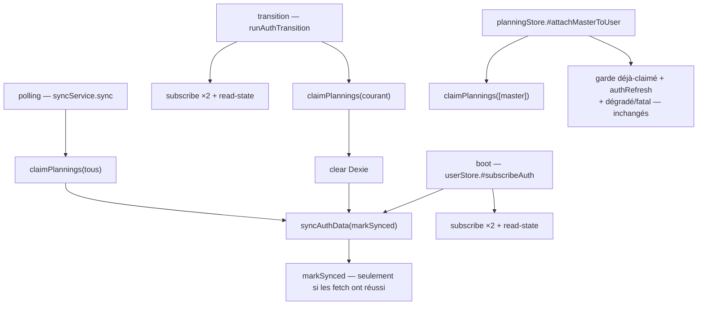

# Spec — 06 : la séquence de données post-auth a un seul propriétaire

**Issue** : [issues/06-auth-data-sync.md](issues/06-auth-data-sync.md) · **Revue** : candidate 6, `.scratch/architecture-review/20261015-212715.html`
**Date** : 2026-10-18 · **Statut** : prête pour implémentation (grilling bouclé, décisions verrouillées ; ticket re-scopé)

## 1. Objectif

Deux défauts réels, et rien d'autre :

1. **Le payload du claim est recopié trois fois** : [syncService](../../../src/lib/services/syncService.ts) (tous les masters), [authTransition](../../../src/lib/utils/authTransition.ts) (le planning courant), [planningStore.#attachMasterToUser](../../../src/lib/stores/planningStore.svelte.ts) (un master) ; la forme du triplet se retrouve en plus dans les tests.
2. **La transition guest→auth n'appelle jamais `markAuthSynced`**, alors que la doc de [userStore](../../../src/lib/stores/userStore.svelte.ts) désigne ce chemin. Conséquence : la « Dernière sync » affichée reste périmée après une connexion, jusqu'au prochain polling réseau ou redémarrage.

Le ticket d'origine demandait de centraliser *toute* la séquence (`fullResync` avec `subscribe` et `read-state`). La mesure du code ne le justifie pas : les trois chemins ne partagent que **fetch + marqueur** ; tout le reste diverge pour de bonnes raisons.

## 2. Décisions arrêtées (grilling en session, 2026-10-18)

| # | Décision |
|---|---|
| D1 | **`claimPlannings(masters)`** dans `src/lib/services/claimPlannings.ts`. Nom : on revendique des **plannings**, les tokens sont la preuve. `_Avoid_: claimTokens`. N'importe que `pb` et un type local → aucun store, donc importable par les stores et services sans cycle. |
| D2 | **`syncAuthData(markSynced, deps?)`** dans `src/lib/services/authDataSync.ts` : `fetchAllMasters` → `syncActiveOccurrences` → `markSynced`. Le marqueur appartient à `userStore` (ADR-0009) et est **injecté** ; son **moment** appartient au module. `deps` optionnel ne sert qu'aux tests (surcharge des deux fetch). |
| D3 | **Marqueur structurel** : `markSynced` est après les fetch dans le même corps → un échec de fetch saute le marqueur, sans `try/catch` défensif ni « mode dégradé » interne. |
| D4 | **Pas de `fullResync`, pas de `subscribe` dans la séquence.** Le SDK PocketBase dédoublonne le transport par `(topic + options)` et se resouscrit automatiquement après reconnexion ; souscrire depuis le polling n'empilerait que des listeners locaux (N handlers par événement). |
| D5 | **Politique d'erreur** : `syncAuthData` **lève**. Boot et transition catchent, avertissent et poursuivent (subscribe + read-state) ; le polling propage, car `networkStore.runResyncOnce` s'appuie sur l'échec pour son retry. |
| D6 | **Transition** : `claimPlannings` **avant** le clear de Dexie (les tokens y vivent), `syncAuthData` **après**. |
| D7 | **`#attachMasterToUser`** garde sa garde « déjà claimé », son `authRefresh` et sa politique dégradé/fatal ; seule la construction du payload délègue. |
| D8 | **Aucun nouvel ADR** : décisions réversibles, documentées en code + cette spec. Glossaire : entrée **« Claim de plannings »**, distincte de « Claim-admin ». |
| D9 | **Le cycle `userStore → syncService` est interdit.** C'est ce que les modules neutres évitent. `syncService` peut importer `userStore` (sens unique, pour le marqueur) ; l'inverse non. |

## 3. Interface des modules

```ts
// ── src/lib/services/claimPlannings.ts — n'importe que pb + un type local ──

export interface ClaimablePlanning {
	id: string;
	participantToken?: string;
	adminToken?: string;
}

/** Revendique des plannings pour le compte courant (hook serveur idempotent).
 *  Lève sur échec : la politique (dégradé / fatal) appartient au caller. */
export async function claimPlannings(masters: ClaimablePlanning[]): Promise<void>;

// ── src/lib/services/authDataSync.ts — n'importe que data/planningSync ──

export interface AuthDataSyncDeps {
	fetchMasters: () => Promise<void>;
	fetchOccurrences: () => Promise<void>;
}

/** Fetch masters → fetch occurrences → marqueur de fraîcheur.
 *  `markSynced` est injecté (propriété du store) ; son ordre est fixé ici.
 *  Lève si un fetch échoue — le marqueur n'est alors pas posé. */
export async function syncAuthData(
	markSynced: () => Promise<void>,
	deps?: Partial<AuthDataSyncDeps>
): Promise<void>;
```

Câblage (un seul site de construction du payload) :

```ts
// syncService.#doSync — polling
const masters = await db.masters.toArray();
await claimPlannings(masters);
await syncAuthData(() => userStore.markAuthSynced());

// userStore.#subscribeAuth — boot
await syncAuthData(() => this.markAuthSynced());

// authTransition — le wrapper injecte
syncAuthData: () => syncAuthData(() => userStore.markAuthSynced());

// planningStore.#attachMasterToUser — garde/authRefresh/politique inchangés
await claimPlannings([master]);
```

## 4. Flux cible



## 5. Non-objectifs

- `subscribe` et `read-state` dans la séquence : ils restent chez les deux appelants qui en ont besoin.
- Idempotence de `subscribe()` dans pb-sync : le SDK gère la reconnexion, le sujet est clos.
- Toute modification de l'interface des collections pb-sync ([05a](issues/05a-pb-sync-contracts.md)).
- Le cycle d'orchestration `userStore ↔ planningStore ↔ authTransition.svelte` (voir [04](issues/04-identity-session-p-token.md)).

## 6. Critères d'acceptation

- Un seul `POST /api/sync-plannings` dans `src/` (grep).
- Le marqueur n'est **invoqué** que dans `syncAuthData` ; les appelants passent la référence (`() => userStore.markAuthSynced()`), jamais un appel direct hors du module.
- Test unitaire `authTransition` : ordre `claim → clear → syncAuthData → subscribe → read-state`.
- Test d'intégration : après `transitionToAuth`, `userStore.lastAuthSyncAt` n'est plus `null`.
- Aucun cycle `userStore → syncService` (le graphe d'imports reste acyclique sur cette arête).
- `bun run check` + `bun run test:unit` + `bun run test:integration`.

## 7. Fichiers touchés

| Fichier | Nature |
|---|---|
| `src/lib/services/claimPlannings.ts` | nouveau |
| `src/lib/services/authDataSync.ts` | nouveau |
| `src/lib/services/syncService.ts` | `sync()` consomme les deux modules ; payload supprimé |
| `src/lib/stores/userStore.svelte.ts` | `#subscribeAuth` appelle `syncAuthData` |
| `src/lib/utils/authTransition.ts` + `src/lib/stores/authTransition.svelte.ts` | dépendance `syncAuthData` injectée ; payload supprimé |
| `src/lib/stores/planningStore.svelte.ts` | `#attachMasterToUser` délègue le payload |
| `tests/unit/authTransition.test.ts` | ordre mis à jour |
| test d'intégration (nouveau ou existant) | marqueur après transition |
| `CONTEXT.md`, `docs/architecture/stores.md`, doc de séquence auth | vocabulaire + flux |

## 8. Risques

- **Contournement du module** : un futur caller qui réécrit le POST fait retomber l'invariant. Mitigation : critère grep + nom explicite.
- **Test d'ordre** : il dépend de l'injection de `syncAuthData` dans `AuthTransitionDeps` ; sans elle, le test ne peut observer que des effets.
- **Marqueur** : `userStore.markAuthSynced` reste le seul écrivain ; le module ne fait que l'appeler au bon moment.

## 9. Écarts avec le ticket d'origine

| Ticket d'origine | Décision |
|---|---|
| `claimTokens(masters)` | renommé `claimPlannings` (les tokens sont la preuve, pas l'objet) |
| `fullResync()` avec `subscribe` + `read-state` | retiré : le SDK se resouscrit seul, le polling ne doit pas souscrire |
| « la séquence vit dans une seule fonction » | remplacé par « fetch + marqueur dans une fonction » ; subscribe/read-state restent à leurs deux appelants |
| marqueur appelé par le module | conservé, et rendu structurel |
| module dans `syncService` | deux modules neutres, sans import de store |
