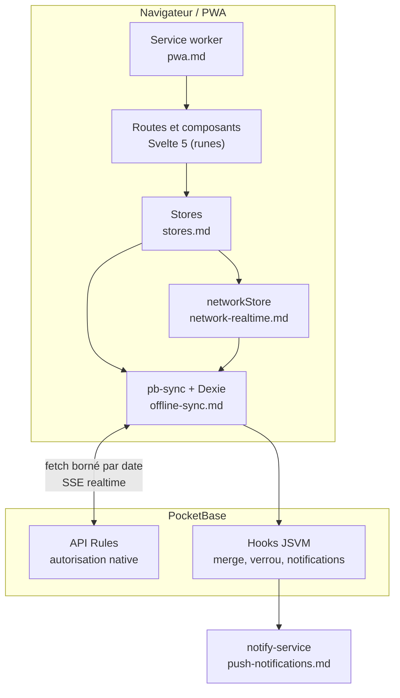

# Architecture

Documentation d'architecture **versionnée** : elle décrit le fonctionnement du code et les
invariants qu'un agent ou un développeur doit connaître avant d'y toucher. Elle est
attendue à jour avec le code, sans quoi elle devient un piège.

Décisions : `docs/adr/`. Terminologie : `CONTEXT.md` (racine). Documentation locale
(propre au déploiement de l'auteur, non versionnée) : `.agents/doc/this-app/`.

## Blueprint

Trois invariants structurent l'ensemble :

- **L'autorisation vit dans les API Rules** ; les hooks JSVM ne font que ce que les règles
  ne peuvent pas (merge de tableaux JSON, verrou, notifications, routes par token).
- **Le client ne lit jamais PocketBase directement** : tout passe par pb-sync et Dexie, la
  base locale servant de source de lecture réactive.
- **Les données hors ligne ne dépendent pas du cache du service worker** : le SW ne sert
  que les assets statiques.

## Index

| Document                | Sujet                                                                                                                                   |
| ----------------------- | --------------------------------------------------------------------------------------------------------------------------------------- |
| `auth-identity.md`      | Deux natures d'utilisateur, résolution d'identité, transition guest → auth, revendication, fin de session                               |
| `stores.md`             | Règle de couche et boucles acceptées, propriété des tables Dexie, `userStore`, `guestStateStore`, `planningStore` (activation et cache) |
| `offline-sync.md`       | Offline-first, fenêtre de re-sync, merge serveur, `_version`, retry                                                                     |
| `network-realtime.md`   | `networkStore` (détection, debounce, retour au premier plan), souscriptions realtime                                                    |
| `admin-lock.md`         | Verrou d'édition admin : collection, routes, TTL, cycle de vie UI                                                                       |
| `push-notifications.md` | File d'événements, canaux, détecteurs, préférences, appareils abonnés                                                                   |
| `pwa.md`                | Service worker, détection de mise à jour, installation, toast                                                                           |

## Conventions

- Un fichier = un sujet. Le nom de fichier sert d'index.
- Écrire ce que le code ne dit pas : invariants, pièges, trade-offs, « pourquoi ». Un
  commentaire ou un document qui paraphrase le code vieillit sans valeur.
- Un renvoi pointe vers du code, une ADR ou `CONTEXT.md`. Jamais vers un plan, un ticket ou
  une spec : ces artefacts disparaissent et laissent un lien mort.
- Diagrammes Mermaid : le type (`flowchart TD`, `sequenceDiagram`, `erDiagram`) est la
  **première ligne** du bloc ; les directives `%%{init: …}%%` viennent en dessous. Un
  commentaire en tête masque le type et route le bloc vers le mauvais parseur.
- Pas d'historique de chantier (« fichiers supprimés », « avant, on faisait… »). Le _pourquoi_
  durable appartient aux ADR ; le _quoi_ changeant ne survit pas.

Le détail des règles de maintenance documentaire (où écrire, qui met à jour quoi) est dans
`AGENTS.md`, qui les porte aussi pour les agents.
