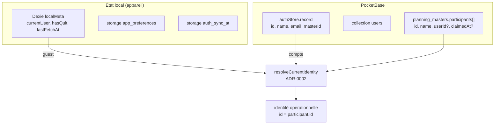
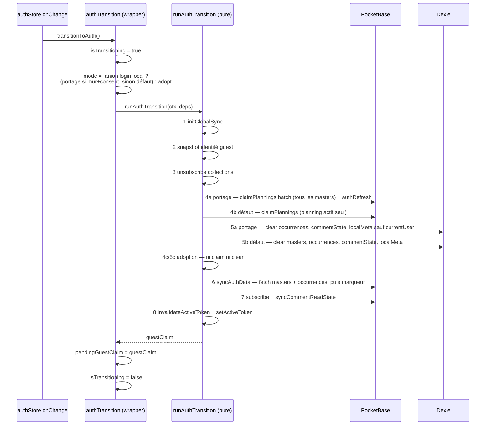

# Authentification, identité et stockage

Comment un utilisateur s'identifie sur un planning, et comment cette identité est
stockée, résolue et migrée. Vocabulaire : `CONTEXT.md` (Compte, Guest, Identity,
Claim-admin, Identité revendiquée, Saved planning, Token).

Décisions associées : ADR-0001 (token en query parameter), ADR-0002 (identité scopée au
planning), ADR-0009 (séparation observation/transition auth), ADR-0013 (suppression de
compte).

## Deux natures d'utilisateur

|                           | Guest                                         | Compte                                          |
| ------------------------- | --------------------------------------------- | ----------------------------------------------- |
| Identité                  | locale à l'appareil, **scopée à un planning** | globale au compte PocketBase, cross-device      |
| Source de vérité          | Dexie `localMeta.currentUser`                 | `pb.authStore.record`                           |
| Nom affiché               | par planning, indépendant du compte           | idem — le nom du compte ne s'impose pas         |
| Realtime                  | souscription per-planning, scopée par token   | souscription globale, filtrée par les API Rules |
| Plannings dans la sidebar | non listés                                    | listés                                          |

Un Guest n'a **pas** de profil universel : le même appareil peut porter des noms
différents sur deux plannings. C'est une invariant du modèle, pas un effet de bord.

## Mur d'authentification (app installée)

Dans l'app installée (mode standalone), un Guest n'a pas accès à l'application :
sans session authentifiée, le layout racine rend un mur plein écran
(`AuthWall.svelte`) à la place de toute surface — connexion ou création de Compte,
sans contournement. Justification : les deux canaux de notification (push, email)
ne servent que des Comptes ; une app installée sans Compte serait structurellement
muette, incapable de tenir la promesse d'alertes qui motive l'installation.

- **Condition** (layout racine, aucun guard par route) : `installStore.isInstalled &&
userStore.isReady && !userStore.isLoggedIn`. Le gate `isReady` empêche tout flash
  de mur pendant la restauration d'une session valide au boot.
- **Le navigateur est hors du mur** : création de planning sans compte, identification
  par planning et liens de participation restent sans friction (ADR-0002 inchangé).
- **Migration** : la création de compte depuis le mur propose le **portage des plannings
  locaux** (bascule « Rattacher les plannings de cet appareil », visible si des masters
  existent en Dexie, cochée par défaut) : claim batch + clear sélectif — voir
  « Transition guest → auth ». Le login d'un compte existant et toute transition hors mur
  (navigateur) gardent la transition standard : claim du planning actif seul + clear total.
  Limites acceptées : le rattachement est irréversible (aucune route de détachement), et un
  profil partagé rattacherait les plannings d'un autre — d'où la bascule, jamais de silence.
- **iOS** isole le stockage Home Screen : le mur y demande une reconnexion même si la
  session vit dans Safari — friction plateforme, pas un défaut du mur. Conséquence pour le
  portage : aucun candidat local, la bascule ne s'affiche pas.

## Résolution d'identité (ADR-0002)

Fonction pure `resolveCurrentIdentity` (`src/lib/utils/identityResolution.ts`) — aucun
store, aucun `$state`. Elle arbitre auth > guest > identité revendiquée, dans cet ordre :

| Cas              | Condition                                          | Résultat                                                             |
| ---------------- | -------------------------------------------------- | -------------------------------------------------------------------- |
| Auth lié         | participant dont `userId === pbUser.id`            | `identity = { id: participant.id, name: participant.name, email }`   |
| Auth non lié     | aucun participant avec ce `userId`                 | `identity = pbUser` — **transitoire**, la stratégie CAS B/C enchaîne |
| Guest revendiqué | participant trouvé, mais `participant.userId` posé | `identity = null`, `claimedByAuth: true`                             |
| Guest identifié  | participant trouvé par `id`                        | `identity = guestIdentity`                                           |
| Guest anonyme    | pas d'identité locale                              | `identity = null`                                                    |

**Invariant central** : quand un participant est résolu, `identity.id = participant.id`.
C'est la clé de toutes les données du planning — réponses, commentaires, quit. Après un
claim, le participant conserve son UUID guest (seul `userId` est posé) : utiliser
`pbUser.id` comme identité opérationnelle casse l'écriture des réponses, l'attribution
des commentaires et le guard de re-identification.

`resolveActorIdentity({ pbUser, guestIdentity })` est la variante légère, sans matching de
participant ni détection `claimedByAuth` : elle répond seulement à « qui suis-je » pour le
verrou admin, les archives et le backfill des commentaires. Elle existe pour concentrer la
précédence auth > guest en un seul endroit et empêcher la divergence entre call sites.

## Transition guest → auth

Déclenchée par le callback `pb.authStore.onChange` de `userStore.init()`, quand
`isLoggedIn` passe de false à true. Le schéma est en deux couches, séparées par ADR-0009 :

- `src/lib/stores/authTransition.svelte.ts` — wrapper réactif : guards `isTransitioning`,
  snapshot `pendingGuestClaim`, `clearPendingGuestClaim()`, `transitionToAuth()`.
- `src/lib/utils/authTransition.ts` — `runAuthTransition(ctx, deps)`, fonction pure
  entièrement injectée (testable avec des fakes). Aucun `$state`.

Points d'attention, tous vécus :

- **Le snapshot se lit sur `guestStates`**, jamais via `getIdentityForPlanning` : à cet
  instant `isLoggedIn` est déjà true, donc la résolution retournerait le Compte au lieu
  de l'identité guest.
- **Trois modes, selon l'origine du login** (`AuthTransitionMode`) : le fanion
  « login local » est posé par les surfaces de connexion avant `authWithPassword` et
  consommé par le wrapper — sans lui, la session est arrivée par l'événement `storage`
  du SDK (une **autre fenêtre du même profil** s'est connectée, l'onglet ouvert l'entend
  aussi) et la transition passe en **adoption** : sync + réabonnements, sans claim ni
  clear. Sans ce mode, l'onglet resté ouvert rejouait la transition destructive sur le
  même IndexedDB et détruisait le portage de l'app (plannings perdus de la sidebar,
  suggestion apparue dans le navigateur au lieu de l'app). La fenêtre adoptante ne
  propose jamais la fusion (`guestClaim` forcé à null) — c'est à l'origine de la
  transition.
- **Portage (création de compte au mur uniquement)** : le consentement transite par
  `authTransition.wallPortageConsent` — posé réactivement par `AuthWall` avant submit
  (le callback `onChange` n'accepte pas d'argument), consommé une seule fois. La double
  garde `installStore.isInstalled && consent` garantit que le parcours navigateur reste
  strictement au comportement par défaut.
- **En portage, l'étape 5 est sélective** : occurrences et `commentState` (caches
  re-remplis), `lastFetchAt` et `hasQuit` (jetables) sont vidés ; les masters (tokens
  d'accès, la sidebar vit dessus) et `currentUser` (seule donnée non reconstruisible)
  survivent. `initialFetch` étant un upsert pur, un claim batch raté (hors-ligne) laisse
  les plannings visibles et fonctionnels — réclamés à la prochaine activation/sync.
- **En portage, l'`authRefresh` qui suit le claim batch** propage `masterId`/`adminOf`
  au record d'auth local — sans lui, les guards UI (accès admin) resteraient obsolètes
  jusqu'à la première activation d'un planning.
- **Par défaut, l'étape 5 vide `localMeta` intégralement** (identités guest et marqueur
  `lastFetchAt`) et **l'étape 4 n'envoie qu'un seul planning**, celui de la page courante.
  Derrière le mur, aucun planning n'étant activé, ce claim est un no-op — seul le portage
  rattache les plannings d'un invité multi-plannings.
- **L'étape 4 est non bloquante** dans les deux branches : un échec réseau n'empêche pas
  la suite ; en portage, rien n'est détruit (auto-réparation), par défaut les données
  guest orphelines sont jetées volontairement.
- **L'étape 6 est le seul endroit qui pose le marqueur de fraîcheur** (`lastAuthSyncAt`,
  `userStore`) : `syncAuthData` possède la séquence fetch → marqueur. Une transition qui ne
  passe pas par lui laisse la « Dernière sync » périmée jusqu'au polling suivant.
- `pendingGuestClaim` est **in-memory, non persisté** : une transition ne survit pas à un
  reload. La suggestion peut aussi naître de l'identité persistée (voir « Claim d'identité »).

## Claim d'identité

Quand un Guest crée un compte ou se connecte, deux identifiants cohabitent : l'UUID guest
utilisé comme `participant.id`, et l'id du Compte. Sans mécanisme, l'`$effect` de la page
créerait un second participant, cassant l'affichage du participant courant.

La stratégie vit dans `/p/[token]/+page.svelte`, par ordre de priorité strict :

| Priorité | Cas        | Condition                                                      | Action                                             |
| -------- | ---------- | -------------------------------------------------------------- | -------------------------------------------------- |
| 1        | CAS A      | participant déjà lié (`userId`, `!hasQuit`)                    | sync silencieuse, aucun modal                      |
| 2        | Suggestion | indice (mémoire ou persisté) ciblant ce planning, cible valide | auto-open du modal, étape suggestion               |
| 3        | CAS B      | participant non lié de même nom (case-insensitive)             | auto-open du modal, étape principale               |
| 4        | CAS C      | aucun des cas précédents                                       | si conflit de nom → modal ; sinon auto-add annoncé |

La suggestion prime sur B et C parce qu'elle porte une information **exacte** (l'UUID du
participant guest), là où B est une heuristique par nom. Deux sources d'indice, unifiées
dans `resolveIdentityStrategy` :

- **`pendingGuestClaim`** (slot mémoire, snapshot de la transition) : la seule possible
  sur le parcours navigateur, puisque la transition standard vide `localMeta`.
- **`localMeta.currentUser` persisté** (portage mur) : durable jusqu'au logout, effacé
  **uniquement par un refus explicite** (qui annonce ensuite l'auto-add). Une invalidité
  (participant claimé ailleurs, quitté) ne l'efface pas — la stratégie retombe simplement
  sur B/C à chaque visite.

La fenêtre de fusion exacte est la session : le logout vide tout, indices compris.

| Élément                                              | Rôle                                                                                                                             |
| ---------------------------------------------------- | -------------------------------------------------------------------------------------------------------------------------------- |
| `/api/claim-participant-identity`                    | migration atomique (`runInTransaction`) : réponses et commentaires ré-attribués au participant cible, `userId` posé sur le guest |
| `Participant.userId`                                 | string simple dans le JSON, **pas une relation PocketBase** — aucune contrainte d'intégrité serveur                              |
| `Participant.claimedAt`                              | marqueur « une seule revendication par planning » : un Compte déjà porteur de `claimedAt` reçoit 409                             |
| `hasNameConflict(participants, name, currentUserId)` | garde d'unicité du nom, côté client uniquement                                                                                   |

Règle de merge du endpoint, quand l'utilisateur avait déjà répondu sous les deux identités :
en cas de valeurs divergentes, la réponse du Compte gagne ; tous les commentaires du
Compte sont ré-attribués à l'UUID guest.

Le modal de claim (`IdentityClaimModal`) calcule son étape courante par `$derived` et n'est
**fermable qu'à l'étape principale**, et seulement si une identité liée valide existe et
qu'aucun conflit de nom n'est en cours. Les étapes suggestion et confirmation forcent un
choix explicite.

## Identité revendiquée depuis un autre appareil

Quand un Guest dont le participant porte un `userId` revient sans s'être connecté
(`claimedByAuth: true`), l'identité est **verrouillée** : pas de réponse possible, bandeau
invitant à se connecter, badge en lecture seule, et surtout **pas d'auto-ouverture** du
modal d'identification. La résolution est la connexion au compte associé, qui repasse par
CAS A.

## Fin de session

| Action                           | Redirige                   | Clear Dexie             | Identités guest                  |
| -------------------------------- | -------------------------- | ----------------------- | -------------------------------- |
| `logout()`                       | oui, vers `/`              | oui, `localMeta` inclus | perdues                          |
| `logoutAndStayOnPlanning(token)` | non, reste sur le planning | oui, `localMeta` inclus | perdues, la page rouvre le modal |
| `deleteAccount()` (ADR-0013)     | oui, après `logout()`      | oui                     | —                                |

`deleteAccount()` appelle `/api/delete-account` (transaction : participations marquées
quittées, `userId` retiré, préférences supprimées, record `users` supprimé). Les plannings
survivent par leurs tokens.

`logoutAndStayOnPlanning()` pose `isTransitioning` pendant toute l'opération : sans ce
guard, les `$effect` des pages réagiraient à l'état intermédiaire (auth vidé, planning pas
encore réactivé).

Dans l'app installée, `logout()` ramène au mur d'authentification. La déconnexion
demande confirmation sur toutes ses surfaces (sidebar, settings) — l'action vide les
données locales dans tous les contextes ; seule la ligne « mur » du confirm dépend de
`installStore.isInstalled`.

## Pièges

- **`pbUser.id` n'est jamais l'identité opérationnelle** d'un participant réclamé. Toute
  nouvelle écriture doit passer par `resolveCurrentIdentity`.
- **La garde d'unicité du nom est côté client seulement.** Rien côté serveur n'empêche
  deux participants actifs homonymes : un client modifié peut les créer.
- **`hasNameConflict` exclut l'utilisateur courant deux fois** (`p.userId === currentUserId`
  et `p.id === currentUserId`). Une seule exclusion suffit à faire boucler la garde après
  un claim réussi, ou à laisser passer un doublon.
- **`pendingGuestClaim` n'est pas persisté** : l'auto-open de la suggestion ne se produit
  qu'au cours de la transition, jamais au reload ou à l'arrivée par lien direct.
- **Le snapshot de transition se fait avant le clear**, sinon l'identité guest est perdue
  et le claim retombe sur l'heuristique de nom.

## Fichiers clés

- `src/lib/utils/identityResolution.ts` — règle ADR-0002 (`resolveCurrentIdentity`, `resolveActorIdentity`)
- `src/lib/utils/authTransition.ts` + `src/lib/stores/authTransition.svelte.ts` — transition guest → auth
- `src/lib/stores/userStore.svelte.ts` — compte, session, préférences, boot
- `src/lib/stores/guestStateStore.svelte.ts` — état guest par planning (voir `stores.md`)
- `src/lib/utils/participantConflict.ts` — garde d'unicité du nom
- `src/lib/components/IdentifyModal.svelte` — identification guest (primo-identification et switch)
- `src/lib/components/auth/AuthWall.svelte` — mur d'authentification de l'app installée (voir `pwa.md`)
- `src/lib/components/IdentityClaimModal.svelte` — revendication et migration pour les Comptes
- `src/lib/components/RenameParticipantModal.svelte` — renommage local, distinct du changement d'identité
- `src/lib/services/planningParticipants.ts` — `addParticipant`, `updateParticipant`, `claimParticipantIdentity`
- `pocketbase/pb_hooks/main.pb.js` — `/api/claim-participant-identity`, `/api/sync-plannings`, `/api/delete-account`
- `src/lib/types/planning.types.ts` — `Participant` (`userId`, `claimedAt`), `PlanningIdentity`, `SavedPlanning`
