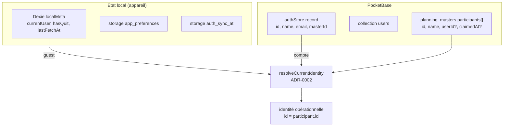
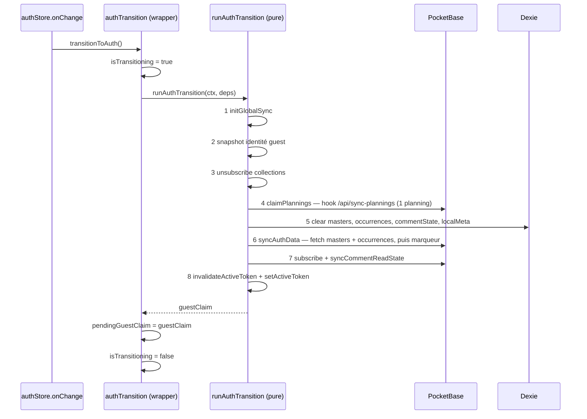

# Authentification, identité et stockage

Comment un utilisateur s'identifie sur un planning, et comment cette identité est
stockée, résolue et migrée. Vocabulaire : `CONTEXT.md` (Compte, Guest, Identity,
Claim-admin, Identité revendiquée, Saved planning, Token).

Décisions associées : ADR-0001 (token en query parameter), ADR-0002 (identité scopée au
planning), ADR-0009 (séparation observation/transition auth), ADR-0013 (suppression de
compte).

## Deux natures d'utilisateur

|                           | Guest                                         | Compte                                          |
| ------------------------- | --------------------------------------------- | ----------------------------------------------- |
| Identité                  | locale à l'appareil, **scopée à un planning** | globale au compte PocketBase, cross-device      |
| Source de vérité          | Dexie `localMeta.currentUser`                 | `pb.authStore.record`                           |
| Nom affiché               | par planning, indépendant du compte           | idem — le nom du compte ne s'impose pas         |
| Realtime                  | souscription per-planning, scopée par token   | souscription globale, filtrée par les API Rules |
| Plannings dans la sidebar | non listés                                    | listés                                          |

Un Guest n'a **pas** de profil universel : le même appareil peut porter des noms
différents sur deux plannings. C'est une invariant du modèle, pas un effet de bord.

## Résolution d'identité (ADR-0002)

Fonction pure `resolveCurrentIdentity` (`src/lib/utils/identityResolution.ts`) — aucun
store, aucun `$state`. Elle arbitre auth > guest > identité revendiquée, dans cet ordre :

| Cas              | Condition                                          | Résultat                                                             |
| ---------------- | -------------------------------------------------- | -------------------------------------------------------------------- |
| Auth lié         | participant dont `userId === pbUser.id`            | `identity = { id: participant.id, name: participant.name, email }`   |
| Auth non lié     | aucun participant avec ce `userId`                 | `identity = pbUser` — **transitoire**, la stratégie CAS B/C enchaîne |
| Guest revendiqué | participant trouvé, mais `participant.userId` posé | `identity = null`, `claimedByAuth: true`                             |
| Guest identifié  | participant trouvé par `id`                        | `identity = guestIdentity`                                           |
| Guest anonyme    | pas d'identité locale                              | `identity = null`                                                    |

**Invariant central** : quand un participant est résolu, `identity.id = participant.id`.
C'est la clé de toutes les données du planning — réponses, commentaires, quit. Après un
claim, le participant conserve son UUID guest (seul `userId` est posé) : utiliser
`pbUser.id` comme identité opérationnelle casse l'écriture des réponses, l'attribution
des commentaires et le guard de re-identification.

`resolveActorIdentity({ pbUser, guestIdentity })` est la variante légère, sans matching de
participant ni détection `claimedByAuth` : elle répond seulement à « qui suis-je » pour le
verrou admin, les archives et le backfill des commentaires. Elle existe pour concentrer la
précédence auth > guest en un seul endroit et empêcher la divergence entre call sites.

## Transition guest → auth

Déclenchée par le callback `pb.authStore.onChange` de `userStore.init()`, quand
`isLoggedIn` passe de false à true. Le schéma est en deux couches, séparées par ADR-0009 :

- `src/lib/stores/authTransition.svelte.ts` — wrapper réactif : guards `isTransitioning`,
  snapshot `pendingGuestClaim`, `clearPendingGuestClaim()`, `transitionToAuth()`.
- `src/lib/utils/authTransition.ts` — `runAuthTransition(ctx, deps)`, fonction pure
  entièrement injectée (testable avec des fakes). Aucun `$state`.

Points d'attention, tous vécus :

- **Le snapshot se lit sur `guestStates`**, jamais via `getIdentityForPlanning` : à cet
  instant `isLoggedIn` est déjà true, donc la résolution retournerait le Compte au lieu
  de l'identité guest.
- **L'étape 5 vide `localMeta`**, donc les identités guest et le marqueur `lastFetchAt`
  (`src/lib/utils/authTransition.ts`, étape 5).
- **L'étape 4 n'envoie qu'un seul planning**, celui de la page courante. Le post-login ne
  synchronise pas les autres plannings connus localement.
- **L'étape 4 est non bloquante** : un échec réseau n'empêche pas le clear, les données
  guest orphelines sont jetées volontairement.
- **L'étape 6 est le seul endroit qui pose le marqueur de fraîcheur** (`lastAuthSyncAt`,
  `userStore`) : `syncAuthData` possède la séquence fetch → marqueur. Une transition qui ne
  passe pas par lui laisse la « Dernière sync » périmée jusqu'au polling suivant.
- `pendingGuestClaim` est **in-memory, non persisté** : une transition ne survit pas à un
  reload, et la suggestion ne se rejoue pas.

## Claim d'identité

Quand un Guest crée un compte ou se connecte, deux identifiants cohabitent : l'UUID guest
utilisé comme `participant.id`, et l'id du Compte. Sans mécanisme, l'`$effect` de la page
créerait un second participant, cassant l'affichage du participant courant.

La stratégie vit dans `/p/[token]/+page.svelte`, par ordre de priorité strict :

| Priorité | Cas        | Condition                                                  | Action                                                |
| -------- | ---------- | ---------------------------------------------------------- | ----------------------------------------------------- |
| 1        | CAS A      | participant déjà lié (`userId`, `!hasQuit`)                | sync silencieuse, aucun modal                         |
| 2        | Suggestion | `pendingGuestClaim.masterId === master.id` et cible valide | auto-open du modal, étape suggestion                  |
| 3        | CAS B      | participant non lié de même nom (case-insensitive)         | auto-open du modal, étape principale                  |
| 4        | CAS C      | aucun des cas précédents                                   | si conflit de nom → modal ; sinon auto-add silencieux |

La suggestion prime sur B et C parce qu'elle porte une information **exacte** (l'UUID du
participant guest de session), là où B est une heuristique par nom.

| Élément                                              | Rôle                                                                                                                             |
| ---------------------------------------------------- | -------------------------------------------------------------------------------------------------------------------------------- |
| `/api/claim-participant-identity`                    | migration atomique (`runInTransaction`) : réponses et commentaires ré-attribués au participant cible, `userId` posé sur le guest |
| `Participant.userId`                                 | string simple dans le JSON, **pas une relation PocketBase** — aucune contrainte d'intégrité serveur                              |
| `Participant.claimedAt`                              | marqueur « une seule revendication par planning » : un Compte déjà porteur de `claimedAt` reçoit 409                             |
| `hasNameConflict(participants, name, currentUserId)` | garde d'unicité du nom, côté client uniquement                                                                                   |

Règle de merge du endpoint, quand l'utilisateur avait déjà répondu sous les deux identités :
en cas de valeurs divergentes, la réponse du Compte gagne ; tous les commentaires du
Compte sont ré-attribués à l'UUID guest.

Le modal de claim (`IdentityClaimModal`) calcule son étape courante par `$derived` et n'est
**fermable qu'à l'étape principale**, et seulement si une identité liée valide existe et
qu'aucun conflit de nom n'est en cours. Les étapes suggestion et confirmation forcent un
choix explicite.

## Identité revendiquée depuis un autre appareil

Quand un Guest dont le participant porte un `userId` revient sans s'être connecté
(`claimedByAuth: true`), l'identité est **verrouillée** : pas de réponse possible, bandeau
invitant à se connecter, badge en lecture seule, et surtout **pas d'auto-ouverture** du
modal d'identification. La résolution est la connexion au compte associé, qui repasse par
CAS A.

## Fin de session

| Action                           | Redirige                   | Clear Dexie             | Identités guest                  |
| -------------------------------- | -------------------------- | ----------------------- | -------------------------------- |
| `logout()`                       | oui, vers `/`              | oui, `localMeta` inclus | perdues                          |
| `logoutAndStayOnPlanning(token)` | non, reste sur le planning | oui, `localMeta` inclus | perdues, la page rouvre le modal |
| `deleteAccount()` (ADR-0013)     | oui, après `logout()`      | oui                     | —                                |

`deleteAccount()` appelle `/api/delete-account` (transaction : participations marquées
quittées, `userId` retiré, préférences supprimées, record `users` supprimé). Les plannings
survivent par leurs tokens.

`logoutAndStayOnPlanning()` pose `isTransitioning` pendant toute l'opération : sans ce
guard, les `$effect` des pages réagiraient à l'état intermédiaire (auth vidé, planning pas
encore réactivé).

## Pièges

- **`pbUser.id` n'est jamais l'identité opérationnelle** d'un participant réclamé. Toute
  nouvelle écriture doit passer par `resolveCurrentIdentity`.
- **La garde d'unicité du nom est côté client seulement.** Rien côté serveur n'empêche
  deux participants actifs homonymes : un client modifié peut les créer.
- **`hasNameConflict` exclut l'utilisateur courant deux fois** (`p.userId === currentUserId`
  et `p.id === currentUserId`). Une seule exclusion suffit à faire boucler la garde après
  un claim réussi, ou à laisser passer un doublon.
- **`pendingGuestClaim` n'est pas persisté** : l'auto-open de la suggestion ne se produit
  qu'au cours de la transition, jamais au reload ou à l'arrivée par lien direct.
- **Le snapshot de transition se fait avant le clear**, sinon l'identité guest est perdue
  et le claim retombe sur l'heuristique de nom.

## Fichiers clés

- `src/lib/utils/identityResolution.ts` — règle ADR-0002 (`resolveCurrentIdentity`, `resolveActorIdentity`)
- `src/lib/utils/authTransition.ts` + `src/lib/stores/authTransition.svelte.ts` — transition guest → auth
- `src/lib/stores/userStore.svelte.ts` — compte, session, préférences, boot
- `src/lib/stores/guestStateStore.svelte.ts` — état guest par planning (voir `stores.md`)
- `src/lib/utils/participantConflict.ts` — garde d'unicité du nom
- `src/lib/components/IdentifyModal.svelte` — identification guest (primo-identification et switch)
- `src/lib/components/IdentityClaimModal.svelte` — revendication et migration pour les Comptes
- `src/lib/components/RenameParticipantModal.svelte` — renommage local, distinct du changement d'identité
- `src/lib/services/planningParticipants.ts` — `addParticipant`, `updateParticipant`, `claimParticipantIdentity`
- `pocketbase/pb_hooks/main.pb.js` — `/api/claim-participant-identity`, `/api/sync-plannings`, `/api/delete-account`
- `src/lib/types/planning.types.ts` — `Participant` (`userId`, `claimedAt`), `PlanningIdentity`, `SavedPlanning`
