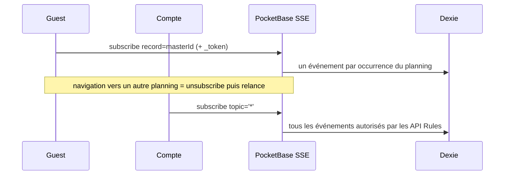

# Réseau et realtime

Comment l'application sait qu'elle est connectée, comment elle est notifiée des
changements, et ce qu'elle fait quand la connexion revient. Vocabulaire : `CONTEXT.md`
(pb-sync).

La politique de re-sync elle-même est dans `offline-sync.md` ; ce document couvre la
détection et le transport.

## `networkStore`

Store singleton qui suit la connectivité du navigateur et l'état de la connexion SSE, et
déclenche les re-sync.

| Membre                  | Rôle                                                                    |
| ----------------------- | ----------------------------------------------------------------------- |
| `online`                | `navigator.onLine`                                                      |
| `realtimeConnected`     | état SSE **débouncé** sur la descente, exposé à l'UI                    |
| `hasActiveSubscription` | au moins un canal pb-sync est souscrit                                  |
| `lastError`             | date de la dernière erreur détectée                                     |
| `lastSyncAt`            | date de la dernière re-sync réussie — curseur de throttle, non persisté |
| `isNetworkOk`           | `online && (!hasActiveSubscription \|\| realtimeConnected)`             |

### Sources de détection

- `window` `online` / `offline` — connectivité navigateur ; `offline` force aussi
  `realtimeConnected = false`.
- `document` `visibilitychange` — retour au premier plan.
- `window` `pageshow` — restauration depuis le bfcache.
- `pb.realtime.onDisconnect` — fermeture de l'EventSource.

### Debounce de la descente

PocketBase ferme une SSE inactive après environ cinq minutes et le SDK la reconnecte en
moins de deux secondes. Sans amortissement, chaque cycle ferait clignoter l'alerte réseau.

- **Montée à `true` : immédiate.** L'alerte doit disparaître vite.
- **Descente à `false` : débouncée à 5 s.** Un seul timer, non réinitialisé par les
  `onDisconnect` répétés pendant les tentatives de reconnexion du SDK.

Deux représentations cohabitent : un état brut non réactif (`realtimeLive`), lu par le
polling pour détecter la transition sans attendre le debounce, et l'état réactif exposé à
l'UI. Les micro-coupures de moins de cinq secondes restent invisibles.

### Polling de reconnexion

Toutes les 2 secondes, un contrôle local de `pb.realtime.isConnected` — aucune requête
réseau. Si une souscription est active, que le SDK se dit connecté et que l'état brut est
encore à false, l'état passe à connecté et une re-sync est déclenchée.

### Retour au premier plan (R6)

Le polling de 2 s est **gelé** par les navigateurs mobiles quand l'application passe en
arrière-plan (environ 30 s sur iOS Safari, parfois moins en PWA autonome). Au retour, il
peut mettre plusieurs secondes à reprendre, laissant l'utilisateur devant des données
périmées. Deux écouteurs DOM corrigent ce cas :

| Écouteur           | Déclenchement                                      | Throttle                    |
| ------------------ | -------------------------------------------------- | --------------------------- |
| `visibilitychange` | retour de l'onglet ou de l'app au premier plan     | 5 s                         |
| `pageshow`         | restauration depuis le bfcache (`event.persisted`) | aucun — un restore est rare |

Ces deux chemins forcent la re-sync **indépendamment de l'état SSE** : après un gel, le SDK
peut se croire connecté alors que des événements ont été perdus silencieusement (TCP
half-open, expiration NAT). Un fetch borné par `date` rattrape ce qui a été manqué.

Un retry léger (une tentative, 2 s) couvre le cas où le réseau n'est pas encore rétabli à
l'instant du retour ; un guard in-flight empêche deux cycles concurrents quand
`visibilitychange` et le polling se chevauchent.

### Deux horodatages à ne pas confondre

|           | `lastFetchAt`                      | `lastSyncAt`                |
| --------- | ---------------------------------- | --------------------------- |
| But       | fraîcheur affichée à l'utilisateur | curseur de throttle de l'UI |
| Portée    | par master                         | globale                     |
| Stockage  | Dexie `localMeta` (persisté)       | mémoire (non persisté)      |
| Écrit par | `planningStore.markFetched()`      | `networkStore` à la re-sync |

`lastSyncAt` n'est marqué **qu'au succès** : une sync échouée ne doit pas bloquer un retry
légitime au prochain retour au premier plan.

**Non-objectif assumé** : pas de heartbeat périodique quand l'application est visible mais
inactive. Le cas (SSE qui tombe silencieusement) coûterait une requête par minute et par
utilisateur actif ; à réévaluer sur observation en production.

### Fraîcheur affichée selon le mode

`NetworkAlert` affiche « Dernière sync : … » depuis deux sources :

| Mode   | Source                                                           |
| ------ | ---------------------------------------------------------------- |
| Guest  | `lastFetchAt` du master actif, en Dexie                          |
| Compte | `userStore.lastAuthSyncAt`, global, persisté sous `auth_sync_at` |

Un horodatage global suffit en mode Compte parce que la sync y est globale : tous les
masters d'un coup, filtrés par les API Rules. Le marqueur est posé par `syncAuthData`
(`src/lib/services/authDataSync.ts`), que les trois chemins post-auth appellent — polling
réseau, boot d'un Compte et transition guest → auth.

## Souscriptions realtime

Les souscriptions passent par pb-sync, pas par le SDK directement. Deux modes, selon qui
est connecté.

|             | Guest                               | Compte                                      |
| ----------- | ----------------------------------- | ------------------------------------------- |
| Topic       | le record du master actif           | `'*'` — collection entière                  |
| Filtre      | occurrences par `master = masterId` | aucun, les API Rules filtrent côté serveur  |
| Auth        | `_token` en query parameter         | session                                     |
| Monté par   | `planningStore.#activatePlanning()` | `userStore.#subscribeAuth()`                |
| Démonté par | `planningStore.#deactivate()`       | `userStore.logout()`, `clearAllLocalData()` |

Le Guest n'a accès qu'à un planning à la fois, via son token : souscrire à la collection
entière serait inutile et coûteux. Le Compte, lui, doit voir bouger tous ses plannings
(sidebar, notifications) : une souscription unique est plus économique que N souscriptions
par planning.

### Gestion des événements

Le callback de pb-sync applique chaque événement à Dexie :

- `delete` — marquage `deleted: true` (soft-delete local) ou suppression franche, selon le
  réglage de corbeille locale de la collection.
- `update` / `create` — merge des champs si le record existe localement, insertion sinon.

La boucle de vie du drapeau `hasActiveSubscription` est alimentée par pb-sync à chaque
souscription ou désabonnement. À la première souscription, l'état `realtimeConnected` est
réinitialisé à `true`.

## Pièges

- **Ignorer les déconnexions pendant une transition.** `onDisconnect` sort tôt si aucune
  souscription n'est active : pendant la bascule guest → auth, les canaux sont démontés
  volontairement, ce n'est pas une panne.
- **Ne pas forcer la sync sur le seul drapeau SSE.** Le drapeau peut être optimiste après
  un gel ; le retour au premier plan et le bfcache déclenchent la re-sync sans le consulter.
- **Le throttle s'appuie sur le dernier succès, jamais sur la dernière tentative.**
- **Un liveQuery Dexie n'est pas une souscription realtime** : le premier observe la base
  locale, la seconde observe le serveur. Les deux sont nécessaires à l'UI réactive.

## Fichiers clés

- `src/lib/stores/networkStore.svelte.ts` — statut, debounce, polling, R6
- `src/lib/pb-sync/collection.ts` — souscriptions et application des événements à Dexie
- `src/lib/stores/planningStore.svelte.ts` — souscription Guest, `refreshActive()`
- `src/lib/stores/userStore.svelte.ts` — souscription globale, `markAuthSynced()`
- `src/lib/services/syncService.ts` — sync globale à la reconnexion
- `src/lib/services/claimPlannings.ts` — claim des plannings locaux (hook idempotent)
- `src/lib/services/authDataSync.ts` — séquence post-auth : fetch → marqueur de fraîcheur
- `src/lib/data/planningSync.ts` — opérations de re-sync (voir `offline-sync.md`)
