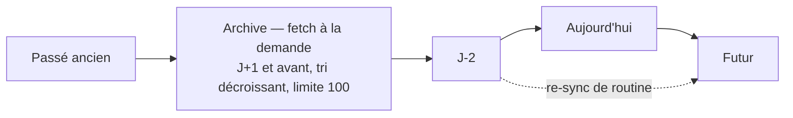

# Synchronisation offline-first

Politique de synchronisation d'oupla : quand l'application refetch, ce qu'elle refetch, et
comment les écritures concurrentes sont réconciliées. Vocabulaire : `CONTEXT.md` (pb-sync,
Dexie, Merge strategy).

Le contrat de la **bibliothèque** pb-sync (API des collections, options de query, batchs,
gestion d'erreur) est documenté à côté de son code : `src/lib/pb-sync/README.md`. Ce
document-ci couvre ce qui est propre à oupla.

Décisions associées : ADR-0003 (offline-first via pb-sync et Dexie), ADR-0017 (fenêtre de
re-sync bornée par `date`, sans curseur client), ADR-0006 (réouverture défensive de la base
locale).

## Principe

Lecture depuis Dexie, écriture vers PocketBase puis miroir local. Dexie est un **cache
technique jetable** : la source de vérité est le serveur, et une base locale corrompue ou
incohérente se règle par un drop, jamais par une réparation manuelle.

| Table Dexie | Contenu |
| --- | --- |
| `masters` | plannings, indexés par token participant et admin |
| `occurrences` | occurrences, indexées par master et par date |
| `localMeta` | état guest par planning et marqueur de fraîcheur (voir `stores.md`) |
| `commentState` | état de lecture des commentaires |

L'instance est ouverte par `ensureDbReady()`, mémoïsé, avec reset automatique si une
migration échoue — sans cette garde, une base locale héritée d'une version antérieure
provoquerait une erreur 500 au boot, sans recours pour l'utilisateur.

Les écritures Dexie passent par un stripper qui sérialise les valeurs : IndexedDB clone en
profondeur et ne sait pas cloner les proxys d'état de Svelte 5.

## Fenêtre de re-sync (ADR-0017)

Toute re-sync est un **fetch complet borné par `date`**. Aucun curseur temporel n'est
produit ni consommé côté client.

| Opération | Borne | Module |
| --- | --- | --- |
| Masters | aucun filtre `date` (un record par planning) | `fetchAllMasters()` |
| Occurrences actives | `date >= J-2`, scope per-master ou global | `syncActiveOccurrences()` |
| Archive | `date < J+1`, tri `-date`, limit 100 | `fetchRecentPastOccurrences()` |

`src/lib/data/planningSync.ts` est le **point de passage obligé** : l'invariant « pas de
curseur client » y vit structurellement, puisque personne ne doit appeler `initialFetch`
directement. `UNBOUNDED_SINCE` neutralise la clause `updated > since` de la bibliothèque
pour ne laisser agir que les bornes `date`.

**Pourquoi ce choix.** L'ancien design utilisait un `since` delta. Le curseur était produit
par `new Date().toISOString()` (horloge locale, format `…T…`) et comparé en TEXT SQLite à
`updated` (horloge serveur, format PocketBase à espace) : la comparaison lexicographique
rendait le curseur postérieur à tout horodatage du même jour, donc **aucune écriture du
jour n'était jamais rattrapée**. Une horloge locale en avance écrasait en plus la fenêtre
correspondante, et le curseur étant persisté, ni le reload ni la re-sync au retour au
premier plan ne réparaient l'état. Le delta a été jugé une économie de fetch sans commune
mesure avec le volume réel (quelques dizaines d'occurrences légères par planning) et avec
la classe entière de bugs qu'il introduisait.

**Conséquence à assumer** : les écritures sur occurrences passées hors fenêtre
(commentaires d'archive très anciens) ne sont rattrapées qu'à la consultation de l'archive
— le realtime les pousse en direct par ailleurs.

## Merge des champs additifs

Les champs tableaux JSON (`participants`, `tasks`, `responses`, `comments`) sont fusionnés
**côté serveur**, atomiquement, par le hook `onRecordUpdateRequest` de
`pocketbase/pb_hooks/main.pb.js`.

Le merge côté client existe toujours dans pb-sync (`mergeByKey`) mais **n'est plus activé
pour oupla** : il imposait un `getOne` préventif suivi d'un `update`, avec une fenêtre de
course entre les deux, pour refaire ce que le serveur fait déjà sans fenêtre.

Sémantique : union par clé d'identité, le local écrase le remote sur les items de même clé.
Les champs non additifs (`title`, `date`, `startTime`…) restent en last-writer-wins natif
PocketBase et ne sont pas touchés par le hook.

### Pièges JSVM

Ces trois points coûtent une session de debug à qui les ignore — ils sont propres à
l'exécution JavaScript embarquée de PocketBase.

- **Un champ JSON est exposé en `[]byte`**, vu depuis JS comme un tableau de nombres
  (`Array.isArray` renvoie `true`). Ce n'est pas un bug : c'est le comportement documenté.
  Il faut passer par `record.getString(field)` puis `JSON.parse()` — `merge-utils.js`
  fournit `jsonArrayField()` pour encapsuler ce pattern.
- **Dans un hook `onRecordUpdateRequest`, le body a déjà été appliqué à `e.record`.**
  `e.record.get(...)` renvoie donc la valeur envoyée par le client, et l'état antérieur
  s'obtient par `e.record.original()`.
- **Muter `e.requestInfo().body` ne fonctionne pas.** Il faut passer par `e.record.set()` ;
  PocketBase persiste ensuite dans une transaction SQLite unique, ce qui rend le merge
  atomique vis-à-vis des requêtes concurrentes.

### Limites connues

- **Modification concurrente d'un même item** : sur un item de même clé, la dernière
  version envoyée gagne, l'autre est perdue. Non corrigé.
- **Résurrection d'item supprimé** : un client en retard qui renvoie une liste contenant un
  item supprimé par un autre le fait réapparaître. Non corrigé ; un soft-delete au niveau
  de l'item serait l'évolution naturelle.

## Contrôle de version sur les scalaires

Le verrouillage optimiste par `_version` reste actif sur les deux collections : la version
envoyée par le client est comparée à `updated`. Une version périmée produit un 409.

Le 409 **n'est jamais retryé** : un retry naïf échouerait à l'identique. Il remonte à
l'appelant, qui déclenche le rollback standard. Le merge des champs additifs n'est pas
concerné (il compare le body à `original()`, pas à `updated`).

## Robustesse des écritures : `withRetry`

`src/lib/pb-sync/retry.utils.ts` exporte un wrapper générique, sans référence métier —
utilisable tel quel quand pb-sync sera extrait dans son propre dépôt.

| Catégorie | Retry |
| --- | --- |
| `status >= 500`, `status === 0`, `TypeError` de fetch, timeout, abort | oui |
| 4xx (400, 401, 403, 404, 409) | non |
| `RecordDeletedError` | non |

Backoff exponentiel avec **full jitter** : `delay = random() * min(cap, base * 2^attempt)`.
Le jitter répartit les retries sur la fenêtre exponentielle, ce qui évite que tous les
clients retombent ensemble quand le serveur revient. Défauts : 2 retries (3 tentatives),
base 500 ms, plafond 8 s.

Seuls les appels réseau de pb-sync sont wrappés (create, update, remove, batch), plus le
batch multi-collections de `updatePlanningWithOccurrences`. Les lectures et les
souscriptions ne le sont pas : la re-sync converge vers le serveur de toute façon, et la
reconnexion SSE est gérée par le SDK et le polling de `networkStore`.

**Interaction avec l'optimistic update** : les retries sont internes au wrapper, et le
rollback Dexie reste piloté par le `try/catch` externe. L'écriture optimiste posée avant le
`try` reste donc visible pendant les tentatives — l'UI ne clignote pas — et le rollback ne
se déclenche qu'à l'échec final.

## Déclencheurs de re-sync

| Moment | Chemin |
| --- | --- |
| Boot d'un Compte | `userStore.#subscribeAuth()`, via `syncAuthData` |
| Transition guest → auth | `runAuthTransition()` étape 6, via `syncAuthData` (`auth-identity.md`) |
| Reconnexion réseau | `networkStore` → `syncService.sync()` (Compte) ou `planningStore.refreshActive()` (Guest) |
| Activation d'un planning | `planningStore.#activatePlanning()` étape 4 |
| Entrée sur l'archive | `planningStore.refreshArchiveOccurrences()` |

`syncService.sync()` (mode Compte) est protégé par un mutex : deux appels concurrents ne
déclenchent qu'une seule passe. Il revendique d'abord les plannings connus localement via
`claimPlannings` (hook `/api/sync-plannings`), puis re-sync masters et occurrences et pose
le marqueur de fraîcheur via `syncAuthData`.

## Pièges

- **Ne jamais rappeler `initialFetch` directement.** Passer par `data/planningSync.ts` :
  c'est ce qui garantit qu'aucun curseur client ne réapparaisse.
- **Ne pas réactiver `mergeStrategies` sur les collections oupla.** Le serveur fait le
  merge sans fenêtre de course ; le remettre côté client réintroduit le `getOne` préventif.
- **Un 409 n'est pas un aléa réseau.** Le retenter est un no-op qui masque un vrai conflit.
- **`upsertRecord` n'écrase pas les champs absents du record distant** : c'est volontaire,
  et c'est ce qui préserve `adminToken` chez un Guest, masqué côté API par `onRecordEnrich`.
- **`upsertLocalMeta` est un patch partiel.** Réécrire le record entier depuis un store
  écraserait les champs d'un autre écrivain (voir la table de propriété dans `stores.md`).

## Fichiers clés

- `src/lib/pb-sync/` — bibliothèque : `collection.ts`, `db.ts`, `batch.ts`, `retry.utils.ts`, `use-live-query.svelte.ts`, `README.md`
- `src/lib/data/planningSync.ts` — opérations de re-sync (point de passage obligé)
- `src/lib/utils/syncWindow.ts` — fenêtres et filtres (`J-2`, archive, `UNBOUNDED_SINCE`)
- `src/lib/data/collections.ts` — collections oupla (masters, occurrences)
- `src/lib/services/syncService.ts` — sync globale en mode Compte
- `pocketbase/pb_hooks/main.pb.js` — hook de merge et contrôle `_version`
- `pocketbase/pb_hooks/merge-utils.js` — `mergeByKey`, `jsonArrayField`
- `tests/integration/server-merge.test.ts`, `tests/unit/retry.utils.test.ts`
