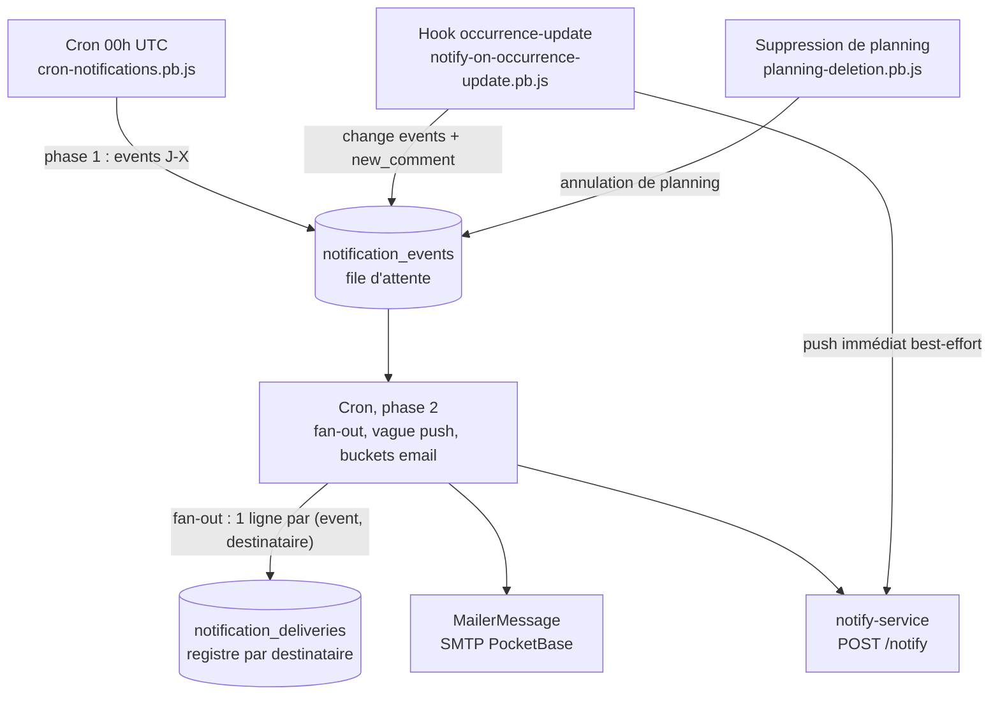

# Notifications

Deux canaux indépendants — email et push — alimentés par une file d'attente
d'événements, plus le cycle de vie des appareils abonnés au push. Vocabulaire :
`CONTEXT.md`.

Décisions associées : ADR-0005 (push via service externe — le JSVM ne peut pas produire de
Web Push, faute de crypto VAPID native), ADR-0007 (extension `.cjs` pour les modules
partagés entre hooks), ADR-0011 (notifications de nouveaux commentaires), ADR-0014
(souscriptions push multi-appareils).

## Principe : producteur, file, consommateur



Le découplage par file donne trois propriétés :

- **Coût constant par mise à jour d'occurrence** : un INSERT, indépendant du nombre de
  participants. L'agrégation se fait plus tard, une fois.
- **Résistance à la panne de push** : un envoi immédiat qui échoue n'est pas perdu, la
  ligne `notification_events` garantit l'email au prochain cron.
- **Insertion sûre en transaction** : une insertion qui échoue est avalée et loggée, elle
  ne casse pas la réponse API de l'écriture d'occurrence.

`notification-events.cjs` est la **seule porte d'écriture** de la table : `insertEvent()`
jette en cas d'échec, et la politique de traitement de l'erreur (avaler en loggant côté
hook, compter côté cron) appartient à l'appelant.

## Canaux

|             | Email                                                       | Push                                                                     |
| ----------- | ----------------------------------------------------------- | ------------------------------------------------------------------------ |
| Émetteur    | `MailerMessage` (SMTP PocketBase)                           | service Docker `notify-service`, `POST /notify`                          |
| Granularité | 1 email par (utilisateur, planning), multipart HTML + texte | 1 push par événement, non agrégé                                         |
| Préférence  | `email`                                                     | `push`, plus `onOccurrenceChange` / `onConfirmationNeeded` selon le type |

Les canaux sont **indépendants** : un participant peut recevoir l'un sans l'autre. Le
service de push est externe (ADR-0005) ; il vit hors de ce dépôt.

## Table `notification_events`

| Champ                   | Type     | Rôle                                                                             |
| ----------------------- | -------- | -------------------------------------------------------------------------------- |
| `type`                  | text     | voir la liste ci-dessous                                                         |
| `master` / `occurrence` | relation | cible                                                                            |
| `reminderValue`         | number   | J-X ; `0` pour les change events                                                 |
| `changedBy`             | text     | userId de l'auteur, pour les change events                                       |
| `payload`               | json     | contexte (avant/après pour un changement d'horaire, compteurs pour les missings) |
| `processedAt`           | datetime | état terminal (consommé ou mort) ; vide = attente de retry email                 |

Types : `reminder`, `quorum_missing`, `task_unassigned`, `confirmation_needed`,
`status_canceled`, `status_deleted`, `schedule_change`, `status_confirmed`, `new_comment`.

## Registre `notification_deliveries`

Une ligne par paire (event, destinataire métier) : la trace de « quelle paire
(event, user) a été servie » sur chaque canal. C'est ce qui découple les
canaux — un email qui échoue (même pour un seul destinataire d'un agrégat)
n'affecte ni le push, ni les autres destinataires — et garantit exactement un
email par (event, user), quelle que soit la cause d'échec.

| Champ                           | Rôle                                                                                                    |
| ------------------------------- | ------------------------------------------------------------------------------------------------------- |
| `event` / `user`                | relation en cascade (purge des events, suppression de compte)                                           |
| `master`                        | dénormalisé pour le bucketing agrégé                                                                    |
| `emailSentAt` / `emailWaivedAt` | email : `''` = dû ; sinon envoyé ou renoncé (opt-out `email`, déjà lu, départ durable, clôture de mort) |
| `pushSentAt` / `pushWaivedAt`   | push : `''` = dû ; sinon envoyé ou renoncé (pref `push` off, type non-J-X, départ durable, clôture)     |

Index unique `(event, user)` ; API Rules toutes verrouillées (table interne,
écrite uniquement par le cron). `notification-deliveries.cjs` est la porte
d'écriture : upsert indexé au fan-out, réglage d'un canal jamais écrasé.

États de fin d'un email dû (pas de cap d'attempts — un compteur ne
distinguerait pas une panne SMTP globale d'une adresse morte) : envoi réussi,
waive (opt-out, déjà lu, départ durable), mort de l'event (garde
d'obsolescence), ou clôture résiduelle (event consommé hors cron). Une adresse
morte est retentée une fois par jour, bornée par le garde d'obsolescence ;
l'erreur loggée signale l'adresse à l'admin.

## Producteurs

### Cron quotidien — `cron-notifications.pb.js`

Cron `0 0 * * *` (00h UTC).

**Phase 1 — détection J-X.** Parcourt les occurrences de `[aujourd'hui, aujourd'hui+20j]`
et insère les événements dus :

| Type                  | Condition                                                                                                 |
| --------------------- | --------------------------------------------------------------------------------------------------------- |
| `reminder`            | J-X dans les `reminderDays` d'un participant, occurrence avec au moins une présence ou une tâche assignée |
| `quorum_missing`      | J-X dans les `missingDays` d'un participant, présents < `minPresentRequired`                              |
| `task_unassigned`     | J-X dans les `missingDays` d'un participant, une tâche a moins d'inscrits que `requiredVolunteers`        |
| `confirmation_needed` | master à `toConfirm`, occurrence non confirmée                                                            |

**Phase 2 — consommation via le registre.** Consomme les lignes non traitées
dans l'ordre : clôture résiduelle (delivery due sur un event qui n'est plus
pending → waive : couvre le cleanup `new_comment` du hook, qui pose
`processedAt` hors cron, et tout save de clôture échoué) ; fan-out (upsert des
deliveries manquantes, filtré aux destinataires avec au moins un canal actif —
prefs lues à chaud, un destinataire qui rejoint à mi-fenêtre est servi) ;
reaper (waive d'une delivery due seulement pour un départ durable :
`hasQuit`, userId retiré du master, user supprimé — jamais pour une response
ou une pref réversible) ; vague push J-X, avant et indépendamment de l'email ;
buckets email agrégés par (utilisateur, planning) avec circuit breaker SMTP
après trois échecs consécutifs ; dérivation terminale ; clôture à la mort.

**Contrat de consommation.** `processedAt` est un état terminal — « l'event ne sera plus
jamais touché » (`notification-consumer.js`), dérivé du registre : un event vivant est
consommé quand toutes ses deliveries ont leurs deux canaux réglés, d'emblée s'il n'en a
aucune (espace vide de destinataires). La terminalité ne se déduit que pour les events
passés par le fan-out du run — jamais d'un simple « 0 deliveries dues », sinon un event
au fan-out sauté (participants illisibles) serait consommé à tort. Tout event vivant sort
du run soit consommé, soit mort sans envoi : occurrence passée (garde d'obsolescence),
annulée ou supprimée pour un event J-X/`new_comment`, master disparu. Les change events
(`status_canceled`, `status_deleted`) font exception — l'état de l'occurrence EST la
nouvelle à délivrer, l'event reste consommable. Le seul état pending résiduel est
l'attente de retry email (SMTP en panne), borné par le garde d'obsolescence.

**Vague push J-X.** Elle part au premier run où l'event est vivant, avant et
indépendamment de la boucle email (un SMTP down ne la retarde pas). Elle est
unique **par destinataire** : seules les lignes dont le canal push est encore
dû partent ; un destinataire apparu au run 2 sur un event encore vivant
reçoit son push au run 2 (fan-out dynamique), ce n'est pas un doublon. Les
types non-J-X naissent avec `pushWaivedAt` posé : leur push immédiat est fait
par le hook occurrence-update, les re-pousser depuis le cron serait un
doublon.

**Purge.** Cron hebdomadaire (lundi 00h30) qui supprime **en natif**
(`app.delete()`) les events terminaux (`processedAt` posé) de plus de 60
jours — les cascades du schéma emportent leurs deliveries, pas de sweep
indépendant. Un `DELETE` SQL brut ne convient pas ici : les cascades de
relation sont appliquées par le runtime sur `app.delete()`, pas par des FK
SQLite (précédent natif : `planning-purge`).

### Hook occurrence-update — `notify-on-occurrence-update.pb.js`

Sur `onRecordAfterUpdateSuccess` d'une occurrence future. Deux chemins :

- **Change events** — `status_canceled` (faux → vrai), `status_deleted`, `schedule_change`
  (date, horaires ou lieu), `status_confirmed` : une ligne dans la file **et** un push
  immédiat aux participants avec `push` et `onOccurrenceChange` à vrai.
- **`new_comment`** — symétrique, via `new-comment-detector.js` (ADR-0011) : chaque
  commentaire ajouté devient un événement poussé immédiatement ; un commentaire supprimé
  marque `processedAt` sur les événements non consommés qui le concernent, pour qu'ils ne
  partent jamais en email.

Le gate est unique : un master soft-deleted ou introuvable ne produit ni événement ni push.
C'est le seul garde du chemin programmatique, un cron ou un script n'ayant pas d'`e.auth`.

### Suppression de planning — `planning-deletion.pb.js`

Un planning supprimé produit des événements d'annulation, afin que les participants
abonnés l'apprennent.

## Destinataires

`computeRecipients` (`notification-recipients.js`, pur, testable) applique dans l'ordre :
participants actifs authentifiés (`userId` défini, `hasQuit !== true`), puis la préférence
métier du type d'événement, puis le filtre de réponse.

| Type                                                                       | Réponses retenues                                                                                                           |
| -------------------------------------------------------------------------- | --------------------------------------------------------------------------------------------------------------------------- |
| `schedule_change`, `status_canceled`, `status_deleted`, `status_confirmed` | non-absent                                                                                                                  |
| `reminder`                                                                 | présent, ou inscrit à au moins une tâche                                                                                    |
| `quorum_missing`, `task_unassigned`                                        | non-absent, sans-réponse inclus                                                                                             |
| `confirmation_needed`                                                      | tous (filtrés ensuite par `onConfirmationNeeded`)                                                                           |
| `new_comment`                                                              | **dynamic** — dépend de `newCommentScope` du participant : `concerned` → sa réaction ou une tâche, `all` → tout le planning |

Le filtre par canal (`email`, `push`) est appliqué au point d'usage, pas dans
`computeRecipients`.

## Préférences

Elles vivent sur `planning_participants` — une ligne par (utilisateur, planning) — et non
sur le compte : on peut vouloir les rappels sur un planning et pas sur un autre.

| Champ                          | Défaut                                                               |
| ------------------------------ | -------------------------------------------------------------------- |
| `push`                         | false — le prompt de permission reste un geste utilisateur explicite |
| `email`                        | true                                                                 |
| `onOccurrenceChange`           | true                                                                 |
| `onConfirmationNeeded`         | false                                                                |
| `reminderDays` / `missingDays` | dérivés du `recurrenceType` du master                                |
| `newCommentScope`              | `all` pour un admin, `concerned` sinon                               |

`getDefaultPlanningPrefs()` n'est appelé **qu'à la création** d'un participant : une
promotion en admin ne réécrit pas une préférence déjà exprimée (ADR-0011).

Le type `PlanningParticipantPrefs` reflète exactement les champs de
`planning_participants`.

## Cycle de vie des appareils (push)

Une ligne par appareil dans `push_subscriptions` — `user` en relation cascade, `endpoint`
unique, `p256dh`, `auth`, `user_agent`, `refreshed_at` (ADR-0014).

**Appareil et préférence sont deux choses distinctes.** La ligne serveur est un appareil ;
`planning_participants.push` est un choix par planning. Le toggle d'un planning ne touche
jamais aux souscriptions : confondre les deux désabonnait l'utilisateur de tous ses
plannings.

| Fonction (`src/lib/services/push.ts`)          | Rôle                                                                                                                                                                                                                                         |
| ---------------------------------------------- | -------------------------------------------------------------------------------------------------------------------------------------------------------------------------------------------------------------------------------------------- |
| `syncPushSubscription({ requestPermission? })` | idempotente et silencieuse : opt-out local ou non authentifié → no-op ; permission non accordée → no-op (jamais de prompt implicite) ; souscription existante → upsert serveur ; sinon, souscription VAPID seulement si un planning a `push` |
| `detachCurrentDeviceFromAccount()`             | logout : retire la ligne serveur **sans** détruire la souscription navigateur                                                                                                                                                                |
| `removeCurrentDevice()`                        | retrait depuis les settings ; pose aussi un opt-out local persistant, sans quoi le prochain sync recréerait la ligne                                                                                                                         |
| `removeRemoteDevice(id)`                       | retrait d'un autre appareil                                                                                                                                                                                                                  |
| `clearPushOptOut()`                            | lève l'opt-out à une réactivation explicite                                                                                                                                                                                                  |

`syncPushSubscription` est appelé à la connexion et à chaque visite déjà authentifiée :
c'est ce qui rattrape une rotation des clés du navigateur.

Côté serveur, `push-subscription.pb.js` expose `POST /api/push-subscription` (upsert par
`endpoint`, avec transfert de propriété entre comptes) et `DELETE /api/push-subscription`
(ligne de l'appelant seulement). L'upsert cross-utilisateur n'est pas exprimable en API
Rules, d'où l'endpoint dédié ; la logique vit dans `push-subscription.cjs` (ADR-0007).

## Contenu

Push : titre par type (`Rappel — {titre}`, `Participants manquants — {titre}`,
`À confirmer — {titre}`), corps avec horaire, lieu et état de la participation, URL cible
`/p/{participantToken}`.

Email : un multipart par (utilisateur, planning), structuré par occurrence et trié par
date. Sujet adaptatif (occurrence unique → date explicite, plusieurs → compteur), blocs par
occurrence, bouton « Voir le planning » en pied. Le contenu d'un message est tronqué à un
aperçu court (`MAX_CONTENT_PREVIEW`).

Les URL sont lues à chaque appel, sans cache de module : `NOTIFY_SERVICE_URL` (service de
push) et `PUBLIC_BASE_URL` (base des liens de clic et d'email) sont donc pilotables sans
redémarrer PocketBase.

## Prérequis VAPID

La clé publique du client (`VITE_VAPID_PUBLIC_KEY`) et la clé privée du service de push
doivent venir de la **même paire**. Un décalage se manifeste en rejets 403 silencieux, le
push étant best-effort par construction.

## Test local de bout en bout

Le push est testable en développement : le service worker est actif sous `vite dev`
(SvelteKit enregistre et sert nativement `/service-worker.js`) et `localhost` est un
contexte sécurisé. Trois processus :

```bash
bun run dev                                             # front — localhost:5173

NOTIFY_SERVICE_URL=http://127.0.0.1:3001/notify \
PUBLIC_BASE_URL=http://localhost:5173 \
  ./pocketbase/pocketbase serve                          # PocketBase

bun run dev                                             # notify-service — port 3001
```

Les deux variables sont lues à chaque envoi : changer de cible ne demande pas de redémarrer
PocketBase. Santé du service : `curl http://127.0.0.1:3001/health`.

Le déclencheur pratique est le hook, jamais le cron (non déclenchable à la demande) :
accorder la permission depuis le modal d'un planning, puis modifier l'horaire d'une
occurrence future. La notification reçue doit s'ouvrir sur
`http://localhost:5173/p/{token}` — c'est l'effet de `PUBLIC_BASE_URL`.

## Pièges

- **Ne jamais importer `web-push` dans un hook.** Le JSVM n'a pas la crypto VAPID (ADR-0005).
- **Le cron n'est pas déclenchable à la demande** et n'a aucune personnalisation horaire :
  les événements J-X du jour partent une fois par jour à 00h UTC. Le hook
  occurrence-update est le déclencheur de test pratique.
- **`insertEvent()` jette.** L'avaler sans logger côté hook perd l'email de secours ; ne
  pas laisser l'exception remonter casse la réponse de l'écriture d'occurrence.
- **Un event push-only est consommé au premier dispatch.** Si notify-service est
  inaccessible à cet instant, le push est perdu (pas d'email en secours, pas de retry) —
  c'est le prix de l'absence de re-push quotidien. L'email, lui, reste garanti par le
  retry.
- **Jamais de `DELETE` SQL brut sur `notification_events`** en opérationnel : les
  cascades de relation sont appliquées par le runtime sur `app.delete()`, pas par des
  FK SQLite — un DELETE brut laisserait des deliveries orphelines. Le SQL brut reste
  légitime en migration (chirurgie de schéma) et en test (`node:sqlite` pour vieillir
  un champ `autodate`).
- **Fenêtre résiduelle incompressible** : un save de marque (`emailSentAt`,
  `pushSentAt`, `processedAt`) qui échoue après un envoi réussi fait repartir cet envoi
  au run suivant — incompressible sans transaction SMTP+DB. La clôture résiduelle du
  registre (delivery due sur event terminal → waive) borne le cas au run d'après et
  couvre aussi tout futur écrivain de `processedAt` hors cron.
- **Un waive n'est pas réversible** : opt-out, départ durable, clôture — revenir sur
  la cause ne rouvre pas la ligne (fenêtre étroite, assumée). Une pref ou une response
  réversible, en revanche, reste évaluée à chaud tant que la ligne est due.
- **`app` est toujours injecté, jamais `$app`** dans les modules de notification : `$app`
  capturé dans un hook deadlocke sur le verrou d'écriture SQLite pendant la transaction du
  save parent.
- **Aucun état au niveau module** dans ces fichiers : les modules JSVM sont évalués une fois
  et partagés entre les runtimes du pool. Le cache du résolveur de contexte master vit sur
  l'instance créée par invocation.

## Fichiers clés

- `pocketbase/pb_hooks/cron-notifications.pb.js` — cron 00h UTC (phases 1 et 2) et purge
- `pocketbase/pb_hooks/notify-on-occurrence-update.pb.js` — hook de changement d'occurrence et de commentaire
- `pocketbase/pb_hooks/notification-events.cjs` — `insertEvent`, résolveur de contexte master
- `pocketbase/pb_hooks/notification-deliveries.cjs` — porte d'écriture du registre de livraison (upsert, réglage des canaux)
- `pocketbase/pb_hooks/notification-consumer.js` — politique de consommation : classification mort/vivant, réglage des deliveries, prédicat du reaper, dérivation de terminalité
- `pocketbase/pb_hooks/notification-jx-detector.js` / `occurrence-change-detector.js` / `new-comment-detector.js` — détecteurs purs
- `pocketbase/pb_hooks/notification-recipients.js` — calcul des destinataires
- `pocketbase/pb_hooks/notify-templates.js` — rendu email
- `pocketbase/pb_hooks/push-dispatch.js` / `notify-utils.cjs` — envoi push
- `pocketbase/pb_hooks/push-subscription.pb.js` / `.cjs` — cycle de vie des appareils
- `pocketbase/pb_hooks/AGENTS.md` — conventions des hooks (source-first, `.cjs`, tests)
- `src/lib/services/push.ts` — préférences et sync des souscriptions
- `src/lib/components/notifications/NotificationsSettingsCard.svelte` — réglages (appareils, par planning)
- `src/lib/components/notifications/NotificationModal.svelte` — demande de permission
- `src/service-worker.ts` — réception du push et clic
