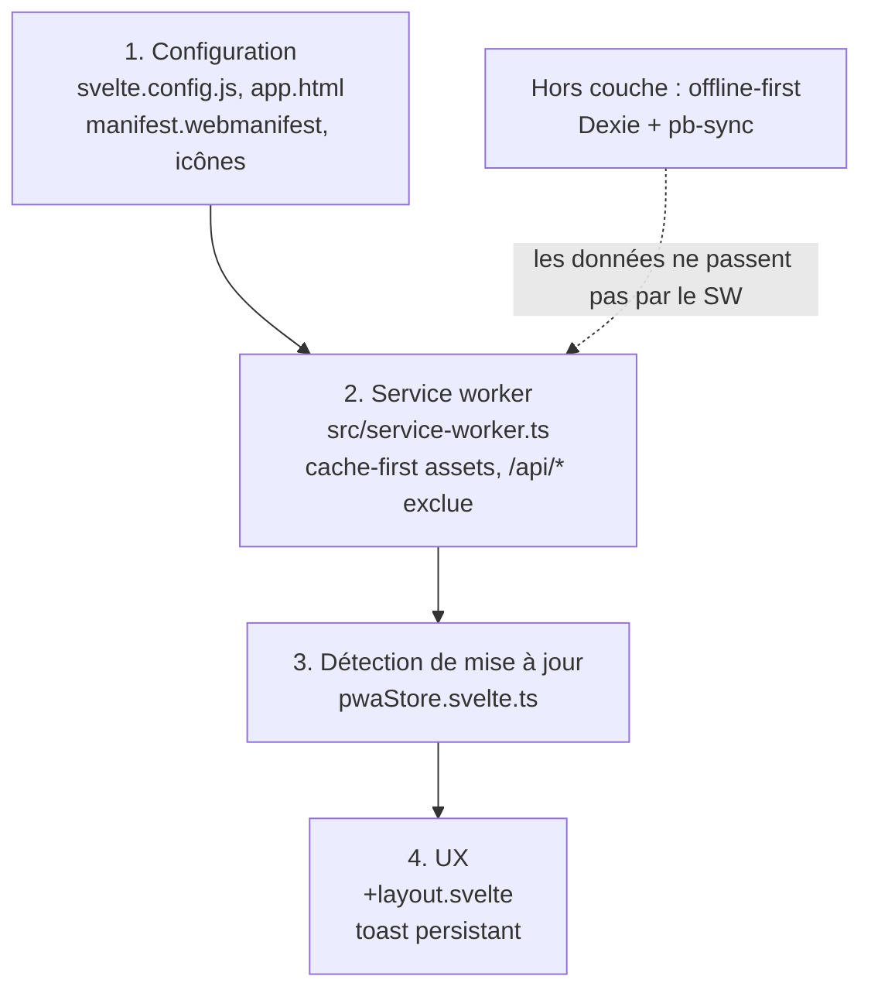

# PWA

Configuration installable (SvelteKit + `adapter-static` en mode SPA) et détection des mises
à jour. Décision : ADR-0004 (adapter-static avec fallback SPA). Guide utilisateur :
`user_guide/pwa-guide.md`.

## Les quatre couches

**Le service worker ne sert que les assets statiques.** Les données hors ligne sont gérées
par Dexie et pb-sync, en parallèle, sans dépendre du cache du SW.

## 1. Configuration

- `svelte.config.js` — `adapter-static` avec `fallback: 'index.html'`, `pages` et `assets`
  sur `build/`. Le fallback SPA laisse le routeur SvelteKit prendre n'importe quelle URL
  côté client ; Cloudflare Pages le sert nativement, sans fichier `_redirects`.
- `src/app.html` — `<link rel="manifest">`, `<link rel="apple-touch-icon">` (iOS ne lit pas
  le manifest pour l'icône d'accueil) et `<meta name="theme-color">`.
- `static/manifest.webmanifest` — écrit **à la main**, SvelteKit ne le génère pas ;
  `adapter-static` le copie tel quel. `display: "standalone"`, icônes 192 et 512, dont une
  en `purpose: "maskable"` — sans elle, Android écrase l'icône dans un masque rond.
- `src/app.d.ts` — l'interface `BeforeInstallPromptEvent`. L'événement `beforeinstallprompt`
  est propre à Chromium et absent de la bibliothèque de types DOM.

## 2. Service worker

`src/service-worker.ts` est le service worker natif de SvelteKit. Il porte quatre
directives de référence de type en tête (`no-default-lib`, `esnext`, `webworker`,
`@sveltejs/kit`) et importe `build`, `files` et `version` depuis `$service-worker`.

| Cycle      | Comportement                                                                                                 |
| ---------- | ------------------------------------------------------------------------------------------------------------ |
| Cache      | nommé `cache-${version}` — le hash de build change à chaque déploiement, donc chaque déploiement a son cache |
| `install`  | pré-cache de `[...build, ...files]`                                                                          |
| `activate` | `clients.claim()` **avant** la suppression des anciens caches                                                |
| `message`  | `skipWaiting()` sur demande du client                                                                        |
| `fetch`    | assets en cache-first, reste en network-first avec repli sur le cache, `/api/*` exclue                       |

**L'ordre du `activate` n'est pas cosmétique.** Supprimer les anciens caches avant le
`claim` laisse un instant où l'ancien contrôleur sert des requêtes contre un cache en cours
de suppression.

**Pas de `skipWaiting()` automatique dans l'`install`.** L'activation est différée à une
action de l'utilisateur : un rechargement au milieu d'une saisie ou d'une mutation en vol
est exactement ce que le report évite.

**`/api/*` est entièrement exclue du `fetch`**, y compris le flux SSE `/api/realtime` (un
stream n'est pas cachable). L'offline-first repose sur Dexie : un SW qui répondrait 200
depuis un cache périmé masquerait une erreur réseau réelle, et l'application afficherait des
données désynchronisées sans aucune alerte. Les routes REST de PocketBase passent donc
directement au réseau.

Le même fichier gère les événements `push` (affichage de la notification) et
`notificationclick` (ouverture de l'URL cible) — voir `push-notifications.md`.

## 3. Détection de mise à jour

`pwaStore.svelte.ts` combine deux moitiés, et chacune est nécessaire :

| Moitié    | Rôle                                                                            | Sans elle                                                                                            |
| --------- | ------------------------------------------------------------------------------- | ---------------------------------------------------------------------------------------------------- |
| Réactive  | `updatefound` puis `statechange` sur l'installation, `reg.waiting` au démarrage | le toast ignore qu'une mise à jour existe                                                            |
| Proactive | `reg.update()` sur les signaux de retour d'activité                             | en SPA, `updatefound` ne se déclenche jamais — aucune navigation serveur n'a lieu pendant la session |

**Le problème de la moitié proactive** : SvelteKit navigue côté client, donc le navigateur ne
revérifie jamais le service worker spontanément. Un utilisateur qui enchaîne les pages
pendant un déploiement ne voit jamais le toast ; il apparaît au rechargement suivant, ce qui
donne la fausse impression d'une mise à jour déjà appliquée.

Trois déclencheurs, throttlés à un par minute (limite de spec) :

| Signal                            | Cas couvert                                                                |
| --------------------------------- | -------------------------------------------------------------------------- |
| `visibilitychange` (visible)      | retour d'onglet ou d'application, cas dominant en PWA mobile               |
| `pageshow` avec `event.persisted` | restauration depuis le bfcache — la SPA n'a fait aucune navigation serveur |
| minuterie d'une heure             | session longue, onglet jamais quitté                                       |

Pas de vérification au démarrage : le navigateur la fait au chargement, et le contrôle de
`reg.waiting` couvre la mise à jour laissée en attente par une session précédente.

**Le throttle ne court-circuite pas une mise à jour déjà en attente.** Un second
déploiement pendant qu'une mise à jour attend doit remplacer l'attente courante : sans
cela, le clic activerait une version intermédiaire et imposerait un second cycle.

L'activation (`applyUpdate()`) envoie `SKIP_WAITING` au service worker en attente ; le
rechargement est déclenché par l'écouteur `controllerchange`, posé au démarrage. À défaut
d'attente (état incohérent), un simple `reload()` suffit.

### Le piège de la première prise de contrôle

`clients.claim()` déclenche `controllerchange` même au premier install, sans qu'aucune mise
à jour n'ait été appliquée. Le store capture donc un drapeau **synchrone au démarrage** :
le premier `controllerchange` est consommé silencieusement, les suivants (issus d'une vraie
mise à jour) déclenchent le rechargement. Un second drapeau (`#refreshing`) évite un double
`reload()` quand l'événement se répète dans la fenêtre de quelques centaines de millisecondes
avant le déchargement — ce n'est pas une boucle, le contrôleur étant établi au rechargement
suivant.

## 4. Installation et UX

`pwaStore` porte aussi l'état d'installation :

| Membre                                 | Rôle                                                                                                                                     |
| -------------------------------------- | ---------------------------------------------------------------------------------------------------------------------------------------- |
| `isInstalled`                          | `display-mode: standalone` ou `navigator.standalone` (Safari), suivi dans le temps                                                       |
| `canInstall` / `deferredPrompt`        | `beforeinstallprompt` intercepté — l'écouteur est posé dès la construction du store, l'événement pouvant précéder le `onMount` du layout |
| `showNativeHint`                       | mobile non-Chromium : ni installé ni promptable, on oriente vers le menu du navigateur                                                   |
| `hasSeenWelcome` / `markWelcomeSeen()` | accueil d'installation vu une fois                                                                                                       |
| `install()`                            | déclenche le prompt différé                                                                                                              |

L'événement `appinstalled` marque l'installation côté PocketBase
(`users.pwa_installed`, seulement si une session est valide) — un repère d'adoption, sans
effet sur le comportement.

Le toast de mise à jour vit dans `+layout.svelte` : `pwaStore.init()` dans `onMount`, puis
un `$effect` sur `hasUpdate` qui affiche un toast **persistant** (durée infinie) tant que
l'utilisateur n'a pas agi. L'identifiant fixe (`sw-update`) est le garde anti-doublon
idiomatique de svelte-sonner : si l'effet se rejoue, le toast existant est mis à jour au
lieu d'être dupliqué.

## Pièges

| Piège                                         | Conséquence                                                                                       |
| --------------------------------------------- | ------------------------------------------------------------------------------------------------- |
| Cacher `/api/*` (REST ou SSE) dans le SW      | 200 périmé sans erreur réseau → données désynchronisées en silence                                |
| `skipWaiting()` automatique à l'`install`     | rechargement en pleine saisie                                                                     |
| Pas de `clients.claim()` à l'`activate`       | le premier service worker n'est actif qu'au rechargement suivant                                  |
| Pas de drapeau de première prise de contrôle  | rechargement intempestif au premier install, ou absence de rechargement sur une vraie mise à jour |
| `reg.update()` au démarrage                   | requête redondante                                                                                |
| Pas de throttle sur `reg.update()`            | trafic inutile (limite de spec : 1 par minute)                                                    |
| `pageshow` sans `event.persisted`             | vérification inutile à chaque navigation client                                                   |
| `visibilitychange` sans test `=== 'visible'`  | vérification au moment où l'onglet devient caché                                                  |
| Pas de `.catch()` sur `reg.update()`          | rejet non traité si hors ligne                                                                    |
| Toast sans identifiant fixe, ou à durée finie | doublons, ou toast qui disparaît avant l'action                                                   |
| Manifest sans icône `maskable`                | icône écrasée sur Android                                                                         |

## Tests manuels

Le service worker est actif aussi en développement — SvelteKit enregistre et sert
nativement `/service-worker.js`, et `localhost` est un contexte sécurisé (push vérifié
de bout en bout). Ces tests demandent néanmoins un build de production : ils exercent le
pré-cache d'assets hachés et le cycle de mise à jour, qui n'ont de sens qu'avec un manifest
de build.

- Premier install silencieux, dans une navigation privée vierge.
- Aller-retour d'onglet → toast sans rechargement (détection proactive).
- Clic « Mettre à jour » → rechargement, nouvelle version active.
- Onglet Network des DevTools : aucune requête `/api/*` servie par le cache, SSE
  `/api/realtime` non intercepté.
- Throttle respecté : au plus une vérification de `/service-worker.js` par minute.

## Fichiers clés

- `svelte.config.js` — adapter-static, fallback SPA
- `src/app.html` — en-tête HTML (manifest, theme-color, apple-touch-icon)
- `src/app.d.ts` — type `BeforeInstallPromptEvent`
- `static/manifest.webmanifest`, `static/icon-{192,512}.png` — manifest et icônes
- `src/service-worker.ts` — cache, cycle de vie, push
- `src/lib/stores/pwaStore.svelte.ts` — détection de mise à jour et installation
- `src/routes/+layout.svelte` — toast de mise à jour et `pwaStore.init()`
